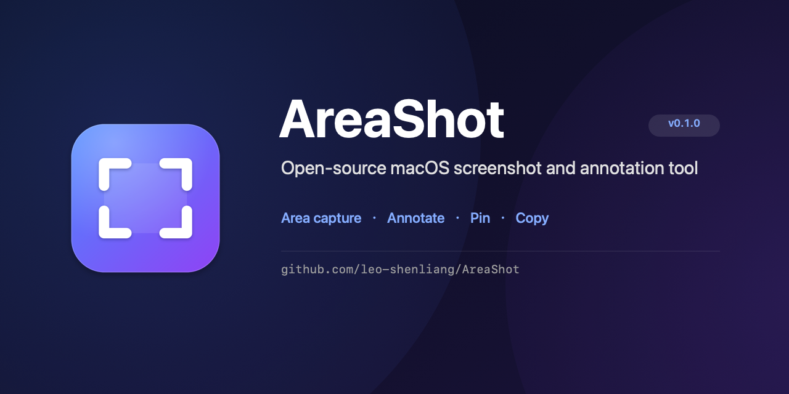

# AreaShot

<p align="center">
  
</p>

<p align="center">
  <a href="https://github.com/leo-shenliang/AreaShot/releases/latest"></a>
  <a href="LICENSE"></a>
  
  
</p>

<p align="center">
  <b><a href="https://github.com/leo-shenliang/AreaShot/releases/latest">Download for macOS</a></b>
  ·
  <a href="#中文说明">中文说明</a>
</p>

AreaShot is a lightweight, open-source macOS screenshot tool. Press one shortcut, drag an area, then annotate, pin, copy, or save — everything stays on your Mac. No account, no upload, no cloud.

Built with Swift and AppKit on top of ScreenCaptureKit. It lives in the menu bar and has no Dock icon.

## Features

- **Area capture** with a single shortcut: `Option + Shift + A`
- **Annotation editor**: arrow, line, rectangle, ellipse, pen, highlight, text, counter, spotlight, loupe, pixelate, blur, and solid redaction
- **Text options**: inline editing, auto-grow, four styles, alignment, weight, font, and size
- **Object editing**: multi-select, move, eight-way resize, snapping, duplicate, copy/paste, layers, lock, and hide
- **Pin window**: keep a capture floating above other windows; drag, resize, or copy it
- **Copy or save**: copy the result to the clipboard or export a PNG
- **Universal build**: Apple Silicon and Intel, macOS 14 or later

> This release exposes area capture only. Fullscreen, window snapping, self-timer, repeat-last-area, clipboard capture, and window shadow are implemented but temporarily hidden in the shared build.

## Install

1. Download the latest DMG from [Releases](https://github.com/leo-shenliang/AreaShot/releases/latest).
2. Open the DMG and drag **AreaShot.app** into **Applications**.
3. On first launch, macOS may say the developer cannot be verified. Right-click AreaShot and choose **Open**, or run:

   ```bash
   xattr -dr com.apple.quarantine /Applications/AreaShot.app
   ```

4. The first time you capture, allow **Screen Recording** in System Settings → Privacy & Security, then quit and relaunch AreaShot.

The app is ad-hoc signed and not notarized, so the manual confirmation above is expected. The DMG and its SHA-256 checksum are attached to every release.

## Use

| Action | Shortcut |
| --- | --- |
| Capture an area | `Option + Shift + A` |
| Undo / redo in the editor | `Cmd + Z` / `Cmd + Shift + Z` |
| Copy / paste annotations | `Cmd + C` / `Cmd + V` |
| Duplicate a selection | `Cmd + D` |
| Delete a selection | `Delete` |
| Copy from a pin window | `Cmd + C` or the copy button |

## Build from source

Requirements: macOS 14+, Swift 6.x (Command Line Tools are enough; full Xcode is not required).

```bash
chmod +x scripts/*.sh
./scripts/build-app.sh
open build/AreaShot.app
```

Create a universal DMG:

```bash
./scripts/package-dmg.sh
```

This writes `dist/AreaShot-<version>-universal.dmg` with an `Applications` shortcut and an install note.

## How it compares

| | AreaShot | CleanShot X | Shottr |
| --- | --- | --- | --- |
| Price | Free | Paid | Free |
| Open source | Yes | No | No |
| Local-only processing | Yes | Yes, with optional cloud features | Yes |
| Annotation editor | Yes | Yes | Yes |
| Pin to screen | Yes | Yes | Yes |

AreaShot is intentionally small: area capture, a focused annotation editor, and pin. If you need scrolling capture, video, or cloud sharing, use a dedicated tool.

## FAQ

**Why does macOS block the first launch?**
The app is not signed with an Apple Developer ID and is not notarized. Right-click → Open, or remove the quarantine attribute as shown above.

**Does AreaShot upload my screenshots?**
No. There is no network code in the app. Captures stay in memory, the clipboard, or the file you export.

**Why is there no Dock icon?**
AreaShot is a menu-bar app (`LSUIElement`). Open it from the menu bar, Spotlight, or Launchpad; the icon is visible in Finder and Applications.

**Why is only area capture shown?**
The other capture modes are present in the code but intentionally hidden in this shared build. They can be re-enabled without changing the capture pipeline.

## Project layout

```
Sources/AreaShot/
  main.swift                 App entry point (accessory mode)
  AppDelegate.swift          Permission checks and capture flow
  StatusItemController.swift Menu bar item and menu
  HotKeyManager.swift        Carbon global hotkeys
  SelectionOverlay.swift     Overlay windows and area selection
  ScreenCaptureService.swift ScreenCaptureKit capture and cropping
  AnnotationEditor.swift     Annotation model and canvas
  AnnotationEditorWindow.swift Editor window, toolbar and actions
  PinWindow.swift            Floating pin window
Support/Info.plist
Support/AppIcon.icns
Support/social-preview.png
scripts/build-app.sh
scripts/package-dmg.sh
scripts/make-icon.swift
scripts/make-social-preview.swift
```

## Known limitations

- Area selection is limited to one screen per capture; cross-screen drags are clamped to the starting screen.
- Crop, rotate, flip, background beautification, and object rotation are not implemented.
- The shared build hides fullscreen, window snapping, self-timer, repeat-last-area, clipboard capture, and window shadow.
- The app is ad-hoc signed; rebuilding changes the signature and may require granting Screen Recording again.

## 中文说明

AreaShot 是一个轻量的开源 macOS 截图工具：按 `Option + Shift + A` 进入区域截图，松开鼠标后进入标注编辑器，可标注、Pin 置顶、复制或保存 PNG。所有处理都在本机完成，没有账号、上传或云服务。

当前分享版只暴露「区域截图」入口。全屏、窗口吸附、定时、重复上次、剪贴板、窗口阴影等模式暂时隐藏，相关实现仍保留在代码中。

### 安装

1. 从 [Releases](https://github.com/leo-shenliang/AreaShot/releases/latest) 下载最新 DMG。
2. 打开 DMG，将 AreaShot 拖入 Applications。
3. 首次打开若提示「无法验证开发者」，右键点击 AreaShot →「打开」，或执行：

   ```bash
   xattr -dr com.apple.quarantine /Applications/AreaShot.app
   ```

4. 首次截图时授予「屏幕录制」权限，然后退出并重新启动应用。

应用使用 ad-hoc 签名，未做 Apple 公证，因此首次打开需要手动确认。每个 Release 都附带 DMG 和 SHA-256 校验文件。

### 功能

- 区域截图与多显示器覆盖层
- 标注：箭头（标准/双头/曲线）、直线、矩形、椭圆、画笔、高亮、文字、序号、聚光灯、放大镜、马赛克、模糊、纯色遮盖
- 文字：内联输入、自动扩展、四套样式、对齐/字重/字体/字号
- 对象：多选、移动、八向缩放、对齐吸附、复制/粘贴、层级调整、锁定/隐藏、图层列表
- 聚光灯可调暗度与椭圆/矩形形状；马赛克/模糊可调强度；序号可重置
- Pin 浮窗：置顶显示、拖动、缩放、复制、关闭
- 编辑结果可复制到剪贴板或保存 PNG；支持撤销/重做

### 从源码构建

```bash
chmod +x scripts/*.sh
./scripts/build-app.sh
open build/AreaShot.app
```

打包通用版 DMG：

```bash
./scripts/package-dmg.sh
```

生成 `dist/AreaShot-<版本>-universal.dmg`，内含 `Applications` 快捷方式和安装说明。

### 已知限制

- 当前只覆盖单屏内选区，跨屏拖拽会被限制在起始屏幕。
- 尚未实现裁剪、旋转、翻转、背景美化和对象旋转。
- 分享版隐藏了全屏、窗口吸附、定时、重复上次、剪贴板和窗口阴影。
- 应用使用 ad-hoc 签名；重新构建会改变签名，可能需要重新授予屏幕录制权限。

## License

MIT
